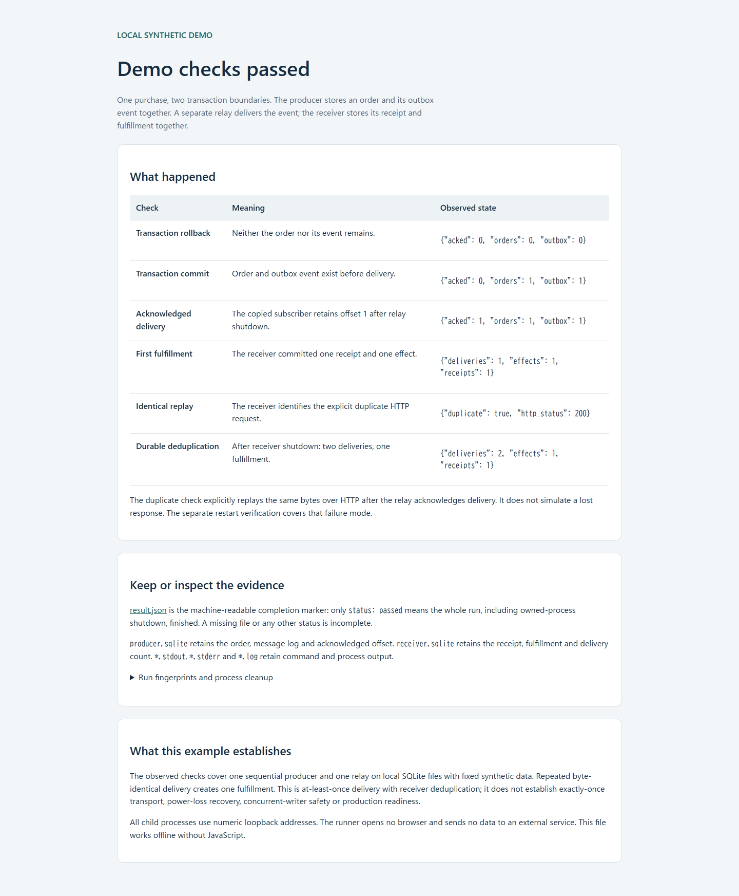

# Local transactional outbox

Store a purchase and its event in one SQLite transaction, then deliver the event
through a separate relay to a durable receiver. Try rollback, acknowledged
delivery and duplicate handling from one terminal, with fixed synthetic data.

## Build on Linux

Requires Go **1.27.2** and Python **3.10+**. From a downloaded or cloned checkout:

```sh
cd app
GOTOOLCHAIN=local GOFLAGS=-mod=readonly GOWORK=off go build -o ../outbox .
cd ..
```

Go downloads normal dependencies on the first build. The module replacements
use the checked-in Watermill and Watermill SQLite implementations. No account,
container, external broker or cloud service is needed to run the demo.

## Run the demo

```sh
python3 tools/run_demo.py --output-dir demo-runs/first
```

The runner starts and stops its receiver and relay on numeric loopback
addresses. It prints six checks and the full report path. Open that
`report.html` file in your browser; it works offline. No browser opens
automatically. To repeat the demo, select a new output directory.

| Check | Expected result |
| --- | --- |
| Requested rollback | 0 orders and 0 outbox events |
| Commit before delivery | 1 order and 1 outbox event, acknowledged offset 0 |
| Relay delivery | Acknowledged offset 1; 1 receipt and 1 fulfillment |
| Explicit identical HTTP replay | Duplicate accepted; 2 deliveries and 1 fulfillment |

Each new output directory retains `report.html`, machine-readable `result.json`,
both SQLite files and command/process logs. Only `result.json` with
`"status": "passed"` marks a completed run, including process shutdown. Failed
and interrupted output is kept for inspection. Existing directories are refused.
The runner processes only its fixed synthetic purchase; it has no input-data flag.

See a [retained example report](examples/demo/report.html) and its
[JSON result](examples/demo/result.json) before running it yourself.



## Operate the commands yourself

The same executable supports `init`, `produce`, `receiver`, `relay` and `inspect`.
See [manual operation and troubleshooting](docs/operations.md) for the individual
commands, expected counts, shutdown behavior and failed-run recovery.

## Implementation and checks

- [app/main.go](app/main.go): producer, loopback HTTP adapter and durable receiver.
- [app/main_test.go](app/main_test.go): transaction, validation, retry and shutdown contracts.
- [VERIFICATION.md](VERIFICATION.md): observed checks and reproducible verification commands.
- [PROVENANCE.md](PROVENANCE.md): copied source revisions, MIT licenses and adaptation boundary.
- [SECURITY.md](SECURITY.md): security limits and problem reporting.

The app executes the included Watermill Forwarder and SQLite Publisher/Subscriber;
the demo runner only orchestrates the existing commands. Copied component bytes
and licenses remain unchanged. See [design references](docs/DESIGN.md) for the
demo's retained workflow and report structure.

## Limits

This local example demonstrates at-least-once delivery with a receiver transaction
that deduplicates byte-identical repeats. It does not promise exactly-once
transport. The duplicate demo explicitly replays HTTP bytes; the separate restart
probe tests a lost response and restarted relay.

Use one sequential producer and one active relay. Watermill SQLite is beta; its
upstream concurrent-transaction test is skipped because the one-connection case
deadlocks. These checks do not establish multiwriter, high availability,
power-loss or production safety. There is no authentication, retention policy,
dead-letter queue or automatic conflict correction. Conflicting event-ID bytes
return HTTP 409 and remain unacknowledged; unavailable receivers remain retryable
and may be retried rapidly. Outbox rows remain after acknowledgment.
